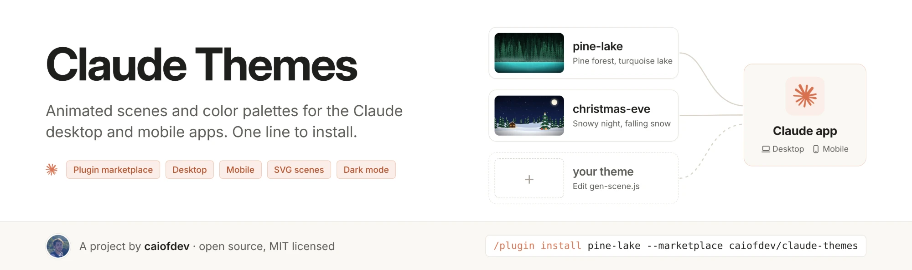
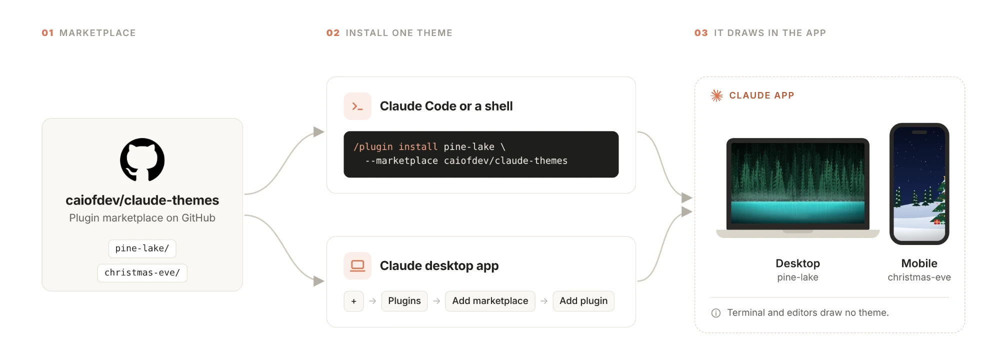

# claude-themes



Themes (mods) for the Claude desktop and mobile apps. Each folder is one theme; this repository is a plugin marketplace, so any theme installs with one line.

## Themes

| Theme | What it looks like |
| --- | --- |
| [`pine-lake`](./pine-lake) | A dark pine forest above a turquoise lake, with slow drifting mist. Deep pine-green surfaces with a turquoise accent, dark mode. |
| [`christmas-eve`](./christmas-eve) | A snowy Christmas night: a lit tree with gifts, a warm cabin, the moon and slow falling snow. Midnight-blue surfaces with Christmas red and gold, dark mode. |

## Install



Replace `pine-lake` with the theme you want. At the prompt of a Claude Code terminal session:

```
/plugin install pine-lake --marketplace caiofdev/claude-themes
```

Answer `y` to add the marketplace, then pick a scope (user scope is first; press Enter).

From a shell:

```
claude plugin install pine-lake --marketplace caiofdev/claude-themes
```

In the desktop app, where `/plugin` does not run: click **+** next to the prompt box, then **Plugins**, **Add marketplace** with `caiofdev/claude-themes`, then **Add plugin**.

The background draws in the desktop and mobile apps; the terminal and editors draw no theme. A session shows one theme at a time, so keep one theme enabled.

## Editing a theme

Each scene is generated SVG. Change it in `<theme>/tools/gen-scene.js`, then regenerate:

```
node <theme>/tools/gen-scene.js <theme>/hooks/scene.ts
```

Keep a scene under 131,072 characters. Each theme's color palette lives in `<theme>/hooks/register.tsx`.

## License

MIT, except `make-colors.js` and `make-colors.d.ts` in each theme's `hooks/` folder. Those are color helpers distributed with Claude Code's mod authoring kit, copied unchanged, and stay under their original distributor's terms. See [LICENSE](./LICENSE).
